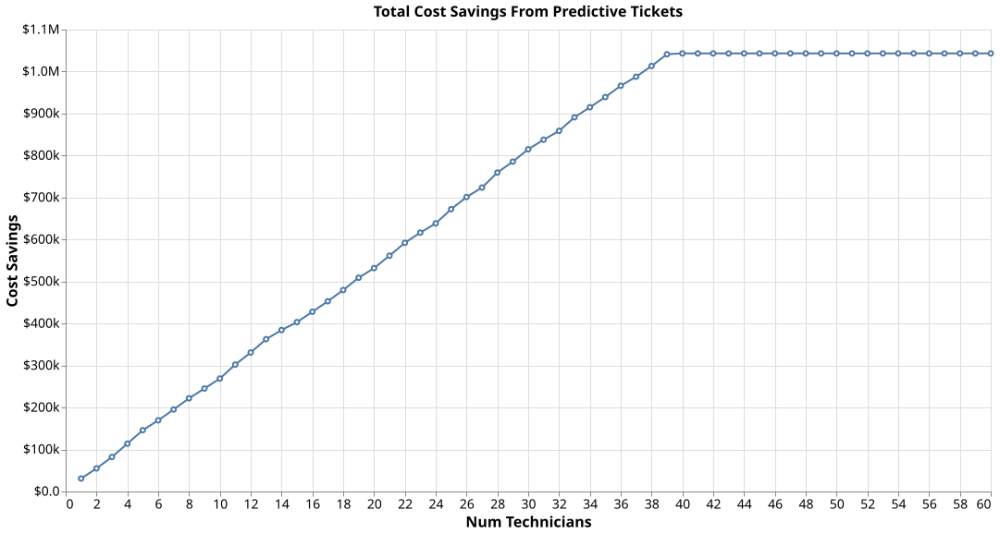
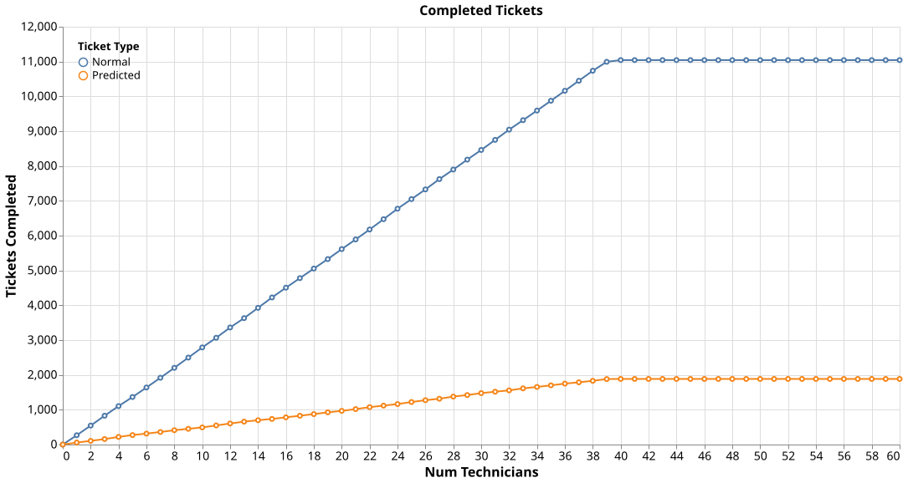
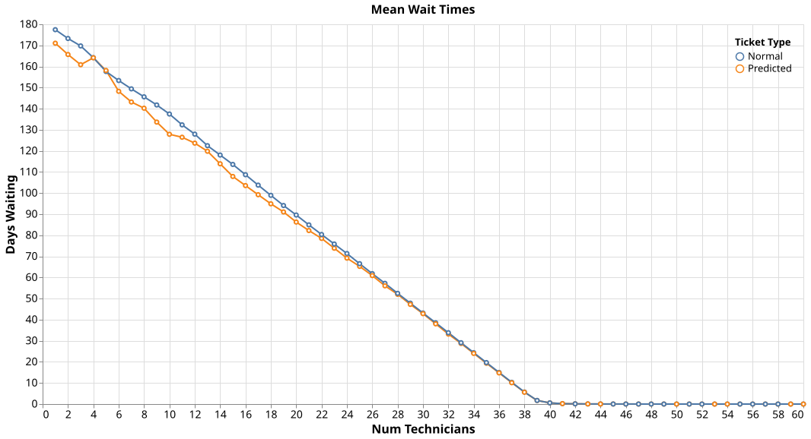
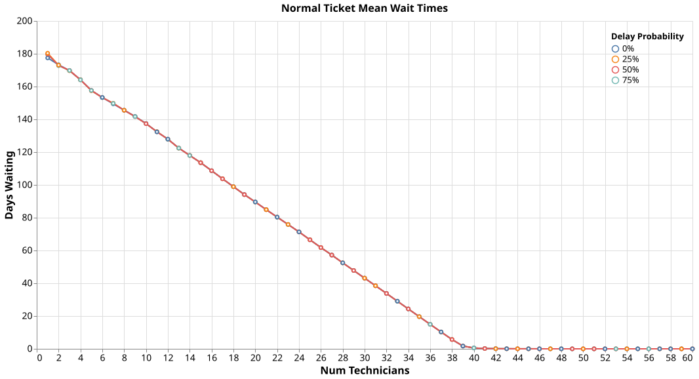
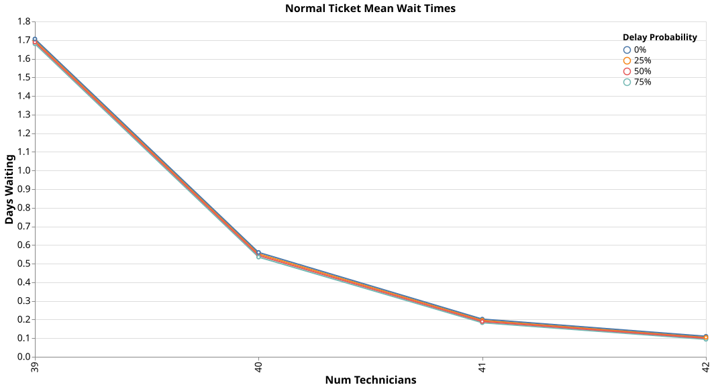
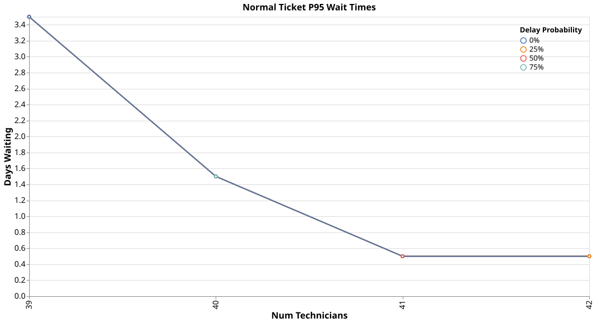
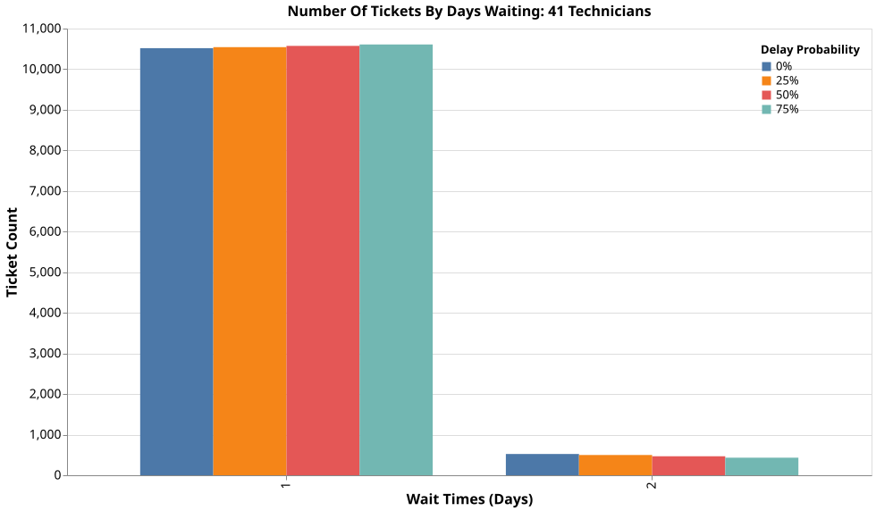
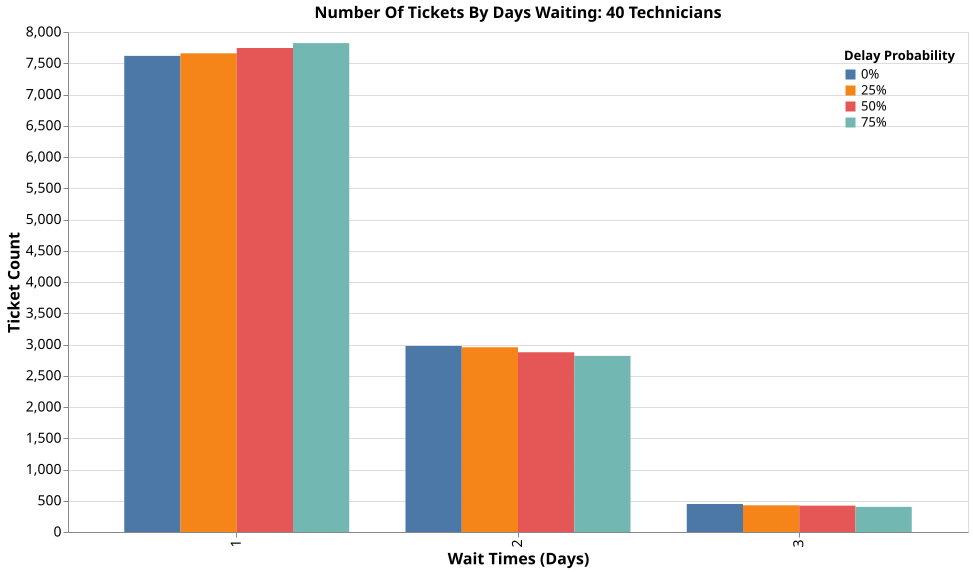

+++
title = 'Simulating The Death Of A Data Science Program'
date = 2026-11-01T00:00:00-04:00
draft = false
mermaid = false
summary = "I've seen data science programs fail for many reasons.  It can happen when the data science work is unsuccessful, such as when a model or ML based product feature never becomes good enough for people to pay for it. Data science programs can also fail because of external changes, resulting in all the value of the program vanishing.  In this post I want to discuss simulating the latter, where a seemingly unrelated business decision results in the program losing it's value."
+++

I've seen data science programs fail for many reasons.  It can happen when the data science work is unsuccessful, such as when a model or ML based product feature never becomes good enough for people to pay for it. Data science programs can also fail because of external changes, resulting in all the value of the program vanishing.  In this post I want to discuss simulating the latter, where a seemingly unrelated business decision results in the program losing it's value.

There has been significant pain in parts of the job market the past few years.  These changes mean companies are restructuring orgs-charts internally and changing their priorities.  In some cases, there is a direct relationship between some business decision and a data science program being cancelled.  For example, if the company you work for sells a product with an additional subscription for AI/ML features, cancelling the product means the subscription gets cancelled as well.  When the subscription revenue goes, the infrastructure and team behind those AI/ML features is probably going to get cancelled as well.

In other cases, there isn't a direct connection between a business decision and the impact it will have on a data science program.  In thinking about the impact of layoffs and organizational restructuring, I got curious if a "seemingly unrelated business decision" could have a disproportionate or unexpected effect on a data science program.  To be clear, I'm not saying only the data science program would be effected.  The impact would be seen in multiple places, but maybe people expected a 10% change to the program, but the impact is closer to 50%.  

To explore this, I tried to simulate a scenario where there was a clear connection between predictions made by a model and a real-world action. That way, if something changed on the "real-world" side of the simulation, it would be easy to work backwards and see how the data science program was impacted.  Staying with the theme of the job market, I wanted to see the impact of a relatively small layoff.
# The Simulation

I wrote a simulation of commercial equipment having issues (e.g. breaking down) across different customers.  When the equipment has an issue, a technician is dispatched from a pool of technicians to fix it.  If there are a lot of technicians and only a few machines breaking down, the machines will get fixed very quickly.  Conversely, if a lot of machines break down and only a few technicians are available to repair them, customers will have to wait for their machines to get fixed.

Examples of equipment and customers are medical equipment in hospitals, machines in factories, construction vehicles on construction sites, elevators in buildings, laptops in businesses, etc.  Conceptualize this however you'd like.  Just remember this is a business scenario where if a piece of equipment breaks, it can really effect operations.  Service contracts for these types of customers also have SLAs, which means technicians need to respond in a defined amount of time.  The bigger the operational impact of a machine having issues, the smaller that time period is going to be.

Introducing a predictive model into this is mostly about reframing these machine issues.  Each time a customer has an issue, they create a service ticket.  Let's say you are a dispatcher, and your job is to review these tickets and assign them to a technician.  After you assign the ticket, the technician goes out and fixes the issue.  This ticket queue has two types of tickets.  A **normal** ticket is when a machine is having an issue and the customer calls for service.  A **predictive** ticket is when an automated model detects some abnormal behavior from the machine and says "We predict an issue is going to occur."  The model pipeline creates a ticket to proactively fix the issue before it occurs and impacts the customer.  The queue is filled with normal and predictive tickets, with the majority of tickets being normal tickets.

To understand how we go from this to a business decision that inadvertently impacts the data science program, let's say the cost of repairing one particular machine issue reactively, after it has already occurred is $1000.  However, if this same issue was predicted and a fix is done before the machine malfunctions, the repair only costs $500.  If there are 4000 of these predictive tickets in a year and we act on all them we save $2 million.

Let's say a business decision is made to layoff 5% of the technicians.  The direct goal of the layoff is to reduce costs, not to change the value of the data science program.  As people plan and explore the effects of the layoff, they estimate it will result in there only being enough technicians to handle roughly 3600 (10% drop) predictive tickets, dropping the savings to $1.8 Million per year.  But after the layoffs occur, someone looks at the actual numbers and it turns out technicians could only handle 2000 predictive tickets, resulting in the savings dropping to $1 Million.  The value of the data science program dropped by 50%, which seems completely out of proportion to the percent of people laid off.

Using a simulation, I could check if this type of impact could actually happen.  

## How The Simulation Works

- The simulation simulates a full year of machine issues/events and technicians repairing them.  It moves forward one virtual day a time.
- At the start of every day in the simulation, there is a queue of tickets.  Each ticket is a machine issue.  These tickets are generated using an exponential distribution, where the wait time between issues for every machine is approximately 14 days.  Predictive tickets are approximately 15% of the total.
- There is a also a queue of technicians.  Technicians who are not currently working on a ticket are assigned one.
- A ticket is associated with a machine.  And a machine is associated with a customer.
- The time or effort required to resolve the issue is defined in the ticket.  The possibilities are a 1/2 day, 1 day, or 2 days.  Tickets which take 1 day to resolve occur much more frequently than 1/2 day tickets or 2 day tickets.  The real world does not work like this.  In the real world you can't accurately estimate how long a repair will take before a technician diagnoses the issue.  Even then, sometimes the estimates are wrong.
- Tickets can roll over to future days and be delayed.  If it's Monday and all the technicians start working on tickets which require 2 days to resolve, none of them will be available to start a new ticket until Wednesday.  So any new tickets on Tuesday are going to be delayed for a minimum of 1 day.
- The simulation runs for 365 virtual days.  
- In the simulation we can track the day the repair started, when it ended, which technician did the repair, etc

Based on the data collected from the simulation, we can calculate things like the average wait time per customer, how busy the technicians are, how many tickets were actually completed out of all the tickets, financial ROI, etc.  Starting at 1 technician and incrementing by 1 each time, we can rerun the simulation until we have enough technicians to complete all the tickets in 365 days.  This allows to precisely see the result of cutting 10%, 20%, 30%, etc of technicians.

Every simulation has approximately 13000 tickets over the course of 365 days.  These tickets occur across 10 customers and each customer has 50 machines.  I picked those values because I wanted about 40 technicians to be enough to complete all the tickets in 365 days of the simulation, and have about $1 million in savings from the predictive tickets.  Why did I choose those numbers?  Mostly because it's easier to read the charts.

# A Sudden Drop In Value

My original hypothesis was a 5% or 10% layoff would result in much larger, disproportionate, drop in savings from the predictive issue tickets.  Turns out my theory was wrong.  To understand why, let's start with looking at the result of the simulation.

Let me explain what's going on in this chart.  Starting with 1 technician, I ran the simulation for the full 365 days.  Then I reran the simulation with 2 technicians, 3 technicians, etc until 60 technicians.  At each step, I calculated how many predictive tickets had been completed.   

Another way to think about this is in terms of tickets completed over the year.  If there's only 1 technician, a small fraction of the 13000 tickets will be completed.  With 41 technicians, there are enough to complete all tickets.  So the cost savings at each point on the x-axis is just a total of all the completed predictive tickets multiplied by the cost savings per ticket.  

Now let's evaluate my hypothesis based on the chart above, assuming the cost savings is $500 per day of effort.  Having 41 technicians results in a total of 1 Million in cost savings.  If we laid off 10% of 41 technicians, we drop to around 37, with $987K of savings. You can see the cost savings for a 20% and 30% layoff in the table below.

| Technicians | Layoff % | Cost Savings |
| :---------: | :------: | :----------: |
|     41      |    0     | 1.05 Million |
|     37      |    10    |     987K     |
|     33      |    20    |     891K     |
|     29      |    30    |     785K     |

It's clear my original hypothesis was incorrect.  Looking at the chart, the drop is very linear, which is just another way of saying a X% drop in technicians results in a X% drop in savings.  To really lose 50% of value, we have to reduce the number of technicians by 50%.

Why this trend is linear can be seen more clearly if we plot the tickets completed compared to the number of technicians.  The chart below plots the normal and predictive tickets. We see a very similar trend to the cost savings chart. This is because the predictive tickets are generally evenly distributed over time, which means these tickets aren't lumped together at a particular time point in the simulation.  

The reason for this is the ticket generation process.  When the tickets were created. The percentage of predictive tickets was set at 15% of the total.  So for any given virtual day in the simulation, the number of completed predictive tickets till that point is going to be approximately 15% of the total tickets completed.  Multiplying this by the cost savings for each ticket takes us straight back to the previous chart. 

A concrete example may help to clarify what I'm tying to say.  Imagine in the simulation, there are 0 predictive tickets till 180 days into the simulation.  If we only have 1 technician, only a few days of tickets are going to be handled by the end of the simulation.  A single technician cannot possibly finish the first 179 days worth of tickets to get to the 180th day before the simulation is over.  If we add up how many predictive tickets that technician was able to complete in the year, the total is 0 because they simply could not get to them.  This will happen with 2 technicians, 3 technicians, etc, until there are enough technicians to address at least 180 days of tickets.  Let's just say the tip over point is 24 technicians.  In the charts above for 0-23 technicians, the lines will basically be flat at 0 for tickets completed and predictive savings.  At 24, we'll see the lines jump up because there are now enough technicians to start handling the predictive tickets.

This simulation does not have this kind of skewed distribution of tickets.  They are generally evenly distribution across the time range in the simulation, resulting in this linear trend.
# Wait Times

With my first hypothesis rejected, I started thinking about other consequences of a layoff.  A direct impact would be how long a customer would have to wait for a technician to come out for a repair after they reported the issue.  For example, if the customer called in the issue on Monday and the technician started working on it on Wednesday, the **wait time** was 2 days.  Assuming your service organization isn't incredibly overstaffed, cutting a percentage of your workforce is going to result in customers having to wait longer for a repair.  As wait times go up, customers will become increasingly frustrated and angry.

Having predictive tickets mixed in with normal ones increases the wait time because it increases the the number of tickets, which increases the technician workload.  The predictive tickets would, in essence, be blocking the normal tickets.  Dealing with this led to a second hypothesis, which I will talk about soon.

Evaluating wait times is important because in Industrial and Commercial settings, customers usually have SLAs (service-level agreements) defining the response or repair/resolution time of the service provider.  Along with angry customers, not meeting SLAs can also have financial penalties.  It's important to keep SLAs in mind when looking at the effect of increasing wait times.

## Overall Wait Time

Before tying wait times back to the data science program, let's first look at the effect of reducing technicians on overall wait times.  People familiar with queueing theory probably know what's coming in this next chart, but to me it was a surprise. 

With 41 technicians the wait time is less than 1 day.  If we cut by 10% we are left with 37 technicians, and a wait time of 10 days!!  With 37 technicians there are approximately 700 tickets left in the ticket queue, which never had a technician assigned to them.  I mention this because the wait time is based on completed tickets, not tickets still in the queue.  So I can only assume the 10 days is optimistic, and would have been higher if the simulation was long enough for these tickets to be included.

Seeing this chart really changed my conceptualization what it meant to reduce the number of technicians.  I've been part of layoffs on both sides (I've survived a layoff, and I've been laid off), and usually people who survived the layoff are just expected to figure out how to pick up the pieces.  I once heard this described as dropping all the balls on the floor and figuring out which ones are important enough to pick back up.  If someone says we're going to have 1 or 2 slow feature development quarters while our Data teams reassess priorities, people will grumble, but it's probably not causing your entire business to fail.

This clearly isn't something you can do with service staff.  Customers are going to be livid if you told them they now have to wait 10 days for someone to respond to an issue with an important machine.  Before you cut field technicians, you have to first figure out how your processes are going to change so you can still meet your SLAs with fewer people. You can't just drop all the balls on the floor and figure out which ones to pick up later.

If I was in upper management in a service organization, I'd be very interested in strategies which allow us to reduce headcount while meeting our contractual obligations. One possibility I'd be very interested in is the impact of the predictive tickets on wait times.  It's very possible someone will point to these and say they are slowing down the response time to the normal tickets, which have SLAs attached to them.  One strategy would be give preference to normal tickets by deferring or ignoring the predictive tickets.

Thinking along these lines led to my second hypothesis; by delaying acting on the predictive tickets in favor of normal tickets, we'd see a tangible shortening of wait times for normal tickets.  Let's explore why performing this type of delay is possible.  The word "predictive" implies the machine issue is going to occur in the future, not today.  So there must be some time window in which we can delay acting on these predictions.  For example, if a model is designed to provide us with 2 weeks of advance notice of a machine issue, we basically have a 2 week window in which we can act on the prediction. If the standard service process is to respond in a week to predictive tickets, delaying to 1.5 weeks should be possible without having a negative impact on the customer.

Another aspect of why it's possible to postpone acting on predictive tickets is because they may not have a contractually defined SLAs attached to them.  An SLA is typically for a currently occurring issue or some sort of predefined scheduled maintenance.  A predictive ticket is for an issue that might (maybe with high probability) occur in the future.  It's possible there is a recommend response time defined internally to the service operation, but it's unlikely to be defined in a contractual SLA.  Delaying acting on the ticket is not going to violate any contractual obligations, meaning there is no legal or financial penalty for doing so.

## Deferring The Predictive Tickets

There are different ways to delay or defer tickets,  so I'll define exactly how it was implemented.  At the start of each simulation day, each ticket is given a priority.  When there are no delays or deferrals, every ticket for that day has the same priority, which means they are assigned to a technician based on their time order in the queue.  This is another way of saying if one customer calls with an issue at 8:56 AM, and another customer calls at 8:57 AM, the ticket from 8:56 is assigned a technician first.  Predictive tickets also have the same time priority as the normal ones.  If a predictive ticket is created at 8:58, and a customer calls at 8:59, the former is assigned before the latter one.

When the predictive tickets are delayed, they are given a lower priority and moved to the back of the day's queue.  So what happens is the normal tickets are assigned to technicians first, and only after all of those are assigned do the predictive tickets get assigned.

In the simulation, instead of delaying all the predictive tickets uniformly, the delay occurs based on a probability.  At the start of every day, there is an X percentage chance the tickets are delayed.  I tried to mirror how I thought a real dispatcher would work.  In the morning, they'd look at the queue and say something like "Our queue is fine and technician availability is good today so we don't have to delay these predictive tickets."  Or, "We're backed up today, let's push these predictive tickets to the back of the queue."

My simulation isn't as sophisticated as real life.  The simulation code doesn't start each virtual day by looking at how backed up tickets are, technician availability, etc.  Instead, a coin is flipped at the start of every day in the simulation to determine if the predictive tickets are delayed.  The probability is the same throughout the simulation.  So, for example, if the probability of delay is 25%, every virtual day there is a 25% chance all the predictive tickets are delayed for that day.

Here are the results with different delay probabilities.  This chart only shows the normal tickets, not predictive tickets.  This is because we want to see if delaying predictive tickets improves wait times for normal tickets, so we focus on those.

Regardless of the delay probability, the impact of the delay on wait times is basically nothing, which I found very counterintuitive at first. After poring through the data, one of the major reasons is how these delays occur.

Let me restate how the delay works.  At the start of each day, we decide if a delay occurs based on some probability.  Let say it's Monday and we have 2 predictive tickets at the front of the queue and 3 normal tickets behind them.  The normal tickets get moved to the front of queue and completed first.  This same pattern repeats on Tuesday, Wednesday, and every single day of the simulation.  What this means is the improvements in wait times are quite small.  The delay really only makes things better for a particular day, but if we look across the entire simulation year, the overall improvement is negligible.  This is reflected in the chart above. 

To try and adjust for this, I changed the delay mechanism so predictive tickets could be delayed not just till later on the same day, but could be virtually kicked down the road for up to 14 days.  This strategy had an unanticipated side effect, which I'll explain with an example.  Let's say every day we have 2 new normal tickets and one new predictive ticket.  Starting the simulation on Monday, our queue has 2 normal tickets and 1 predictive ticket.  We decide to delay the predictive ticket till Tuesday.  Now on Tuesday, we have 2 normal tickets, 1 new predictive ticket, and the old predictive ticket.  We decide to delay them till Wednesday.  Now on Wednesday we have 2 new normal tickets and 3 predictive (1 new, 2 old) tickets.  Keep this going for 14 days and consider what happens.  On the 14th day, we now have a lot of predictive tickets we can no longer delay, all of which are ahead of the normal tickets for that day.

This type of delay can actually result in overall wait time increasing!  This is because while normal tickets have a small reduction in wait time early in the simulation, they get punished as the simulation progresses because of all the delayed predictive tickets which are now clogging up the queue.  The further you are in the simulation, the worse the impact of this is.  I tried playing with different max delay times (e.g. 7 days, 21 days, etc), but it mostly just shifts the bad effects around.  This is not a good strategy to reduce wait times.
### Looking At Delays More Pragmatically 

Instead of looking at the entire spread of wait times from 1 technician till well beyond when the wait time 0, let's think about where an improvement in wait times can really make a difference. If your machine is broken, does it matter if your wait time is 9 days with predictive tickets delayed versus 10 days with no delay?  Would you be less frustrated with 9 days versus 10? Too slow is too slow.  There's no real point in looking at the number of technicians with unfeasible wait times.  On the other side, once you have enough technicians to have a nearly zero wait time, does it matter if you add more technicians?  You already know the answer, the wait time is near zero.  Plotting those has limited value.

Instead, we can zoom in and focus on an area where a small numeric change could have a large practical impact.  For example, if the wait time is 2 days without delaying the predictive tickets, and 1 day with the delay, that could be the difference between a happy or unhappy customer.  Let's see the wait near 40 technicians.

Even in this zoomed in view, we can see the delays make a tiny but still completely immaterial difference.

One major weakness of looking at the average (mean) value is how it obscures what's really going on, and is misaligned with how people really measure a wait time metric.  People familiar with the weaknesses of means will probably find this explanation unnecessary, but I always find clarity helpful.  The mean obscures outliers.  20 tickets with a wait time of 1/2 a day and 2 tickets with wait time of 10 days has a mean which looks acceptable on a slide.  But to a customer, the pain of those two 10 day periods would be burned into their memory a lot more than the 1/2 day ones. 

Instead of looking at the mean times, let's look at a more informative metric that is actually used by service organizations.  The "P95" number tells us the wait times for which 95% of tickets fall below.  This aligns with how an SLA might be written into an actual customer contract, such as "Out of 100 tickets, 95 of them should be resolved in 1 day or less."

Looking at the chart, delaying predictive tickets doesn't have any measurable impact in overall P95 time.  To very honest, I did not expect there to basically be no improvement in both the P95 and Mean wait time charts.  I though there would be some material change, even if the improvement was only half a day.

The problem with looking at an aggregate wait time per technician is we're averaging out the entire simulation into one datapoint.  The P95 number does this less than the mean, but it still does it.  Summarizing the entire year of the simulation into a single datapoint obscures differences happening only in certain time periods of the simulation.

Let's go back to the SLA.  Different customers will have different SLAs.  A better question might be "We are struggling to meet the 1 days SLA for some of our high-priority customers.  Right now, the wait time for those high SLA tickets sometimes slips to 2 or 3 days.  If we delay the predictive tickets, can we make those 1 day?"

Instead of mean and P95, we can get a better view of this by binning the wait times into days (1 day, 2 days, etc.) and seeing how many tickets fall into each bucket. This will give us a much clearer picture of the actual impact of these delays, and we can see how much this shifts individual tickets from one bucket to another.  Let's look at 41 technicians first, where both the P95 and mean wait time is less than 1 day.

Counting tickets in each bucket, we can see a change.  Comparing no delay to a 75% chance of delay, about 100 tickets move from a 2 day wait time to a 1 day (or less) wait time.  That being said, the vast majority of tickets have a wait time of 1 day or less, even without a delay.  Reducing the wait time slightly doesn't provide much practical value.

Let's look at 40 technicians, where the P95 time is 1.5 days.

This shows a better picture of the benefits of delaying the predictive tickets.  A large number of tickets have a wait time of 2 days or longer.  A 75% chance of delay moves close to 200 tickets out of other buckets to a 1 day wait time.  

There is still the practical impact question - out of 11000 normal tickets, we moved 2% of them?  Why would anyone care?  To answer this, we need to think about the SLAs.

Throughout this whole experiment I've treated the customers as homogenous.  In the real world, different size customers have different SLAs.  Really big customers may be less concerned with external service SLAs because they have their own dedicated onsite technicians who can respond immediately to issues.  Smaller customers may be okay waiting a few days for a fix because they can outsource their work when the machine is down.  Only a specific set of customers will have a "1 day or else you're going to feel pain" SLA.  Rather than looking at all customers,  the real question is, "When we sometimes miss the target for our 1 day SLA customers, will delaying the predictive tickets address this?"

Answering this question purely based on tickets per customer, the answer points towards no.  This simulation has 13000 tickets spread across 10 customers, or about 1100 normal tickets per customer.  Even if only a single customer has a 1 day SLA, there's a large gap between 200 and 1100.  Companies willing to pay extra for a high SLA are probably much larger than your average customer, and consequently may generate at least double the ticket volume of your other customers.  So the gap between 200 and that higher number is even bigger.  These type of delays aren't going fix the problem for a single high SLA customer, let alone if you have 2 or more of them.

Before moving to the conclusion, I want to point out something.  The number of predictive tickets moving from a 2 to a 1 day wait time is dependent on the proportion of those tickets compared to the normal tickets.  In this simulation, 15% of the tickets are predictive - a proportion I personally think is too high if a service organization is struggling badly enough to be considering layoffs.  
# So Where Does The Data Science Program Die?

If you haven't noticed, there's still no argument made for how the data science program unintentionally dies.  On the flip side, I haven't really made a case for keeping the program either.  The predictive tickets are clearly causing extra work and delaying the normal tickets.  There are about 2000 predictive tickets, requiring extra technicians to work on them.  One could argue the data science program is saving a million dollars, but the cost of the data team and infrastructure probably exceeds that.   

To me, and I suspect to anybody who has seen these kinds of decisions at big companies, projects and programs need to have a clear reason to exist.  Either something should have a clear and unambiguous financial benefit, or it needs to be  necessary for strategic, legal, or marketing reasons, such as when your competitor has an offering (even when it's junk) and you know you need to have a similar product to be competitive in the market.

When organizations face financial pressures they start asking for a clear demonstration of value.  While people may not be running what-if simulations, the kind of analysis done in this article is how people try to determine the financial benefit of a particular program.  If the conclusion of the analysis is "maybe" or "unclear", the program should cancelled or reworked in a major way.

This analysis is also limited in only looking at two changes, which are cutting back employees and delaying tickets.  In the simulation everything is homogeneous.  The machines are the same, each customer has the same number of machines, and the predictive tickets are all the same with the same financial benefits, and all the technicians are equally skilled. 

The reality of service operations is not homogeneous.  A single facility can have different types of machines with vastly different levels of complexity, resulting in very different issues.  Customers also vary in size, and they each have their own strategies to compensate for a malfunctioning machine, including having backup machines or having someone else they can temporarily outsource to. Technicians have different skill levels, ranging from highly skilled at diagnosis and troubleshooting to people who are mostly good at following instructions.  Geographical constraints also means technicians have a service region, not one big pool of technicians servicing every customer.  There's then the practical day-to-day realities of working hours, people getting sick, and people leaving for a new job.

This is just another way of saying there are lots of factors a service program has to consider when they have to change processes due to financial constraints.  Let's say the goal is to come up with strategies to reduce costs by 10% while meeting all contractual obligations and SLAs.  If you have 5 strategies with clear paths to success, and sitting in the background is your wishy-washy data science program, turning off the predictions and shifting the data science budget to other areas is probably going to have much more impact than trying to determine the optimal delaying strategy for your predictive tickets.  And if the predictive tickets are all gone from your ticket queue, you have one less factor to deal with on the road to implementing your cost reduction plan. 

If you do want to keep the data science program alive, I would recommend revamping it so you can clearly map predictions from a model to a real world consequence, and the consequence should map to clear actions to prevent that consequence.  Doing this correctly should preclude people from saying things like "Yes, your predictions are very accurate.  But the the value of the thing you are predicting is debatable."   If you are interested, I wrote about this topic in a previous article.  [**Is Your Predictive Maintenance Data Science Program Worth it?**]() 

One possible strategy is to focus on a handful of extremely high value use cases.  At one of my previous jobs, an expert identified a small set of machine failures, each of which was worth $150K+ in repair and downtime costs. The actions to prevent these failures were also clear, and only a few separate models were needed to cover the entire set of failures.  Since there were only a few models needed, the actual infrastructure to run the models was minimal and straightforward to update or migrate.  At the end of every fiscal year, calculating the benefit was easy enough for everyone to understand and agree with.

Another approach I've seen is changing to more of a "buffet" style approach organized around scheduled maintenance visits.  A "predictive" system creates a list of non-urgent issues with a machine.  These issues can be based on rules, models, etc.  When someone goes onsite for a scheduled service (e.g. every 3 months), they look at this list and pick the ones that fit into their visit.  For example, a technician looks at this list and sees 5 near-term issues they can resolve alongside their regular maintenance tasks. There are other items in the buffet for them to pick, but those can wait to be done later.  Doing it this way completely removes the SLA considerations, and you never have a predictive ticket in the queue blocking a technician from working on a current customer issue.

Whatever strategies you take,  it needs to make business sense.  Realize you are not only battling financial ROI calculations, but also the ability for people to understand and believe in what you are doing.  If your data science program has middling ROI and you need 20 minutes to explain how that ROI is achieved, people are going to prefer something else where they understand where the benefits come from easily, even if the ROI compared to your data science program is less.

